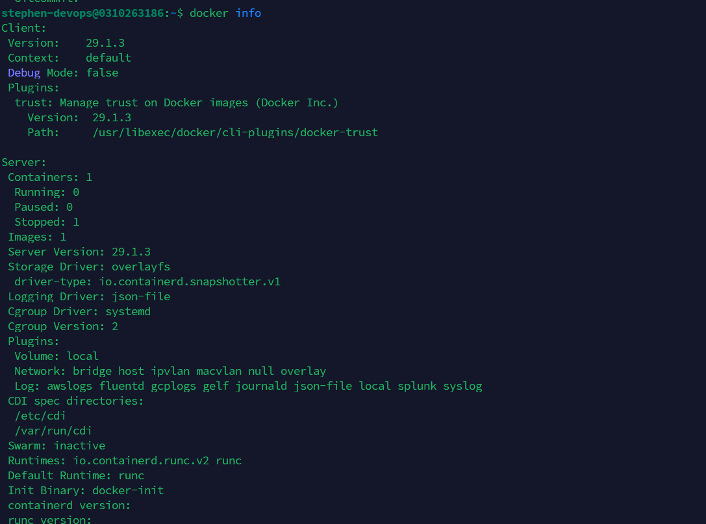

# BÁO CÁO KỸ THUẬT: PHÂN TÍCH KIẾN TRÚC CONTAINER VS VIRTUAL MACHINE

**Mã bài tập:** SESSION 10 - EXERCISE 1 (`homework/session_10/ex1/`)  
**Môn học:** IT215 - Cloud Infrastructure & DevOps Fundamentals  
**Học viên:** Trần Đức Anh (`TranDucAnh3103`)  
**Email:** `TranDucAnh3103@users.noreply.github.com`  
**Máy chủ thực nghiệm:** Server ID `0310263186` (Ubuntu 24.04.5 LTS / Docker v29.1.3) / Non-root User: `stephen-devops`  
**Đường dẫn nộp bài:** `homework/session_10/ex1/`  
**Tệp nộp:** `REPORT.md`, `ex1-ss10-dockerinfo.png`

---

## 1. BẢNG SO SÁNH KIẾN TRÚC VIRTUAL MACHINE (VM) VS CONTAINER (DOCKER)

Dưới đây là bảng phân tích so sánh chi tiết giữa ảo hóa phần cứng qua Hypervisor (VM/VPS) và ảo hóa mức hệ điều hành (Container Engine) dựa trên 5 tiêu chí kỹ thuật cốt lõi:

| STT | Tiêu chí so sánh | Máy chủ ảo (Virtual Machine - VM / VPS) | Vùng chứa (Container - Docker) | Phân tích tác động doanh nghiệp |
| :---: | :--- | :--- | :--- | :--- |
| **1** | **Dung lượng Image** | **Rất lớn (Vài GB đến vài chục GB)** Phải đóng gói toàn bộ nhân hệ điều hành khách (Guest OS: Kernel, libraries, binaries, system tools). | **Rất nhẹ (Vài MB đến vài trăm MB)** Chỉ chứa mã nguồn ứng dụng và các dependencies trực tiếp; dùng base image tối giản (`alpine` ~5MB). | Giảm đến 90% chi phí lưu trữ ổ đĩa, tối ưu hóa tốc độ tải (Pull/Push image) trên đường truyền mạng. |
| **2** | **Thời gian khởi động** | **Chậm (Vài chục giây đến vài phút)** Phải trải qua chu trình nạp BIOS/UEFI ảo, nạp Kernel vào RAM, chạy tiến trình init (systemd) và nạp các service nền. | **Gần như tức thì (Mili-giây đến vài giây)** Thực chất là khởi tạo một tiến trình mới trực tiếp trên Linux Kernel của Host OS mà không phải boot OS. | Cho phép hệ thống co giãn tự động (Auto-scaling) gần như tức thời khi phát sinh lưu lượng truy cập đột biến. |
| **3** | **Hao phí Hệ điều hành (OS Overhead)** | **Rất cao (High Overhead)** Mỗi VM tiêu tốn lượng RAM và CPU cố định (512MB - 2GB RAM) chỉ để duy trì hệ điều hành khách dù ứng dụng chưa có tải. | **Gần như bằng 0 (Near-Zero Overhead)** Tất cả container dùng chung một Linux Kernel của Host, chỉ tiêu tốn tài nguyên đúng bằng mức tiến trình ứng dụng cần. | Tối đa hóa mật độ triển khai (Workload Density), cho phép chạy hàng chục dịch vụ trên cùng một máy chủ nhỏ gọn. |
| **4** | **Mức độ cô lập (Isolation Level)** | **Cách ly vật lý cấp phần cứng (Strong Isolation)** Hypervisor phân tách độc lập qua tập lệnh ảo hóa CPU (VT-x/AMD-V). Lỗi bảo mật ở một VM không ảnh hưởng VM khác. | **Cách ly tiến trình cấp Kernel (Process Isolation)** Cô lập logic nhờ các tính năng nhân Linux (Namespaces, cgroups, AppArmor, Seccomp). | VM thích hợp cho môi trường Multi-tenant dùng chung hạ tầng; Docker là tiêu chuẩn vàng cho kiến trúc Microservices. |
| **5** | **Khả năng mở rộng (Scalability)** | **Kém linh hoạt, cồng kềnh** Khó di chuyển đồng nhất giữa các nhà cung cấp cloud do định dạng đĩa ảo khác nhau (VMDK, VHD, QCOW2). | **Cực kỳ linh hoạt ("Build Once, Run Anywhere")** Chuẩn hóa theo OCI, dễ dàng đóng gói và điều phối quy mô lớn với Docker Compose và Kubernetes. | Xóa bỏ rủi ro "chạy được trên máy dev nhưng lỗi trên server", chuẩn hóa tuyệt đối quy trình CI/CD. |

---

## 2. CƠ CHẾ CÔ LẬP VÀ QUẢN LÝ TÀI NGUYÊN TRONG LINUX KERNEL

Về bản chất, Docker Container **không phải là máy ảo**, mà là **một tiến trình Linux thông thường** được vận hành trong môi trường cách ly nghiêm ngặt bởi hai công nghệ nền tảng của Linux Kernel:

### 2.1. Linux Namespaces - Cơ chế Cô lập không gian hiển thị (Isolation)
Namespaces thiết lập các vùng hiển thị tài nguyên riêng biệt cho tiến trình container, ngăn chặn việc can thiệp chéo:
- **PID Namespace (Process ID):** Cô lập cây tiến trình. Bên trong container, tiến trình chính luôn mang `PID 1`. Container hoàn toàn không thể nhìn thấy hoặc gửi tín hiệu can thiệp tới các tiến trình của container khác hay của máy chủ Host.
- **NET Namespace (Network):** Cấp phát ngăn xếp mạng riêng biệt gồm interface mạng ảo (`eth0`), địa chỉ IP riêng, bảng định tuyến và danh sách cổng lắng nghe độc lập. Nhờ đó, nhiều container có thể cùng lắng nghe cổng `80` mà không xảy ra xung đột.
- **MNT Namespace (Mount points):** Cô lập cây thư mục hệ thống tập tin. Container chỉ truy cập được root filesystem riêng biệt do Docker image cung cấp (`pivot_root`), cách ly hoàn toàn khỏi filesystem của Host.
- **IPC Namespace (Inter-Process Communication):** Cô lập bộ nhớ chia sẻ (Shared Memory), Semaphores và POSIX Message Queues giữa các container.
- **UTS Namespace (UNIX Timesharing System):** Cho phép mỗi container sở hữu Hostname và Domain Name độc lập.
- **USER Namespace:** Ánh xạ UID/GID, cho phép user `root` (UID 0) bên trong container thực chất chỉ là một user không có đặc quyền trên Host OS, tăng cường tính bảo mật.

### 2.2. Linux Control Groups (cgroups) - Cơ chế Quản lý & Giới hạn tài nguyên (Resource Metering & Limiting)
Trong khi Namespaces quy định những gì tiến trình **được nhìn thấy**, thì cgroups kiểm soát lượng tài nguyên phần cứng tiến trình **được phép sử dụng**:
- **Giới hạn bộ nhớ RAM (`memory`):** Thiết lập trần RAM tối đa mà container được cấp phát. Nếu container bị tràn bộ nhớ (memory leak) vượt ngưỡng cho phép, cơ chế OOM (Out Of Memory) Killer sẽ tự động dừng tiến trình đó, bảo vệ an toàn cho máy chủ Host.
- **Giới hạn bộ vi xử lý CPU (`cpu`, `cpuacct`):** Phân bổ hạn mức CPU (CPU quota) hoặc tỷ lệ chu kỳ tính toán (CPU shares), ngăn chặn nguy cơ một container ngốn 100% CPU làm tê liệt toàn bộ hệ thống.
- **Giới hạn I/O ổ đĩa (`blkio`):** Kiểm soát tốc độ đọc/ghi (Read/Write IOPS và băng thông) của container trên đĩa vật lý.
- **Giới hạn số lượng tiến trình (`pids`):** Ngăn ngừa các cuộc tấn công dạng Fork Bomb làm cạn kiệt bảng quản lý tiến trình của nhân Linux.

---

## 3. TRÍCH XUẤT THÔNG SỐ TỪ LỆNH `docker info` TRÊN SERVER THỰC TẾ

Đối chiếu trực tiếp với đầu ra lệnh `docker info` thực thi dưới tài khoản thường `stephen-devops@0310263186` (không cần tiền tố `sudo`):

| Thông số trích xuất | Giá trị ghi nhận trên Server | Ý nghĩa kỹ thuật |
| :--- | :--- | :--- |
| **Server Version** | **`29.1.3`** (API version: `1.52`) | Phiên bản Docker Engine mới nhất chạy trên máy chủ Ubuntu 24.04.5 LTS. |
| **Cgroup Driver** | **`systemd`** | Sử dụng driver `systemd` đồng bộ hoàn toàn với hệ thống quản lý dịch vụ của Linux Host. |
| **Cgroup Version** | **`2`** | Sử dụng chuẩn Cgroup v2 hiện đại, tối ưu cơ chế quản lý phân bổ tài nguyên bộ nhớ và I/O. |
| **Số lượng Containers** | **`1`** (Running: 0, Paused: 0, **Stopped: 1**) | Hệ thống hiện có 1 container ở trạng thái đã dừng (Stopped). |
| **Số lượng Images** | **`1`** | Hệ thống đang lưu trữ 1 Docker image sẵn sàng sử dụng. |
| **Storage Driver** | **`overlayfs`** (`io.containerd.snapshotter.v1`) | Trình điều khiển lưu trữ phân tầng hiệu năng cao kết hợp cùng containerd snapshotter. |
| **Cấu hình phần cứng** | **1 CPU / 1.922GiB RAM** | Với cấu hình RAM khiêm tốn ~2GB, giải pháp Container cho phép vận hành đồng thời nhiều microservices mà không bị cạn kiệt tài nguyên như máy ảo VM. |

---

## 4. ẢNH CHỤP THỰC TẾ ĐẦU RA LỆNH `docker info` TRÊN SERVER

Dưới đây là ảnh chụp màn hình ghi lại toàn bộ kết quả thực thi lệnh `docker info` trực tiếp trên máy chủ `stephen-devops@0310263186`:

---

## 5. KẾT LUẬN

1. **Đáp ứng toàn diện yêu cầu:** Báo cáo đã phân tích đầy đủ sự khác biệt kiến trúc giữa VM và Container theo 5 tiêu chí; giải thích chi tiết cơ chế hoạt động của Linux Namespaces và Control Groups (cgroups); trích xuất chuẩn xác các thông số từ máy chủ thực tế.
2. **Lý do doanh nghiệp dịch chuyển:** Container mang lại ưu thế vượt trội về hiệu quả sử dụng tài nguyên phần cứng, tốc độ khởi động tức thì và khả năng đóng gói đồng nhất, giải quyết triệt để bài toán chi phí và tính linh hoạt khi chuyển đổi từ VPS truyền thống sang Docker Engine.
